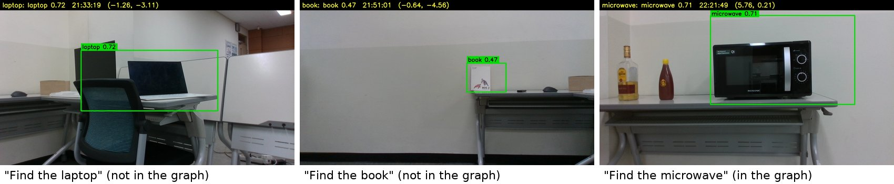
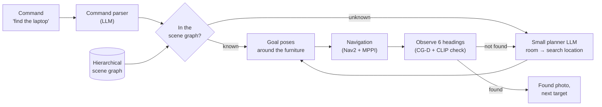
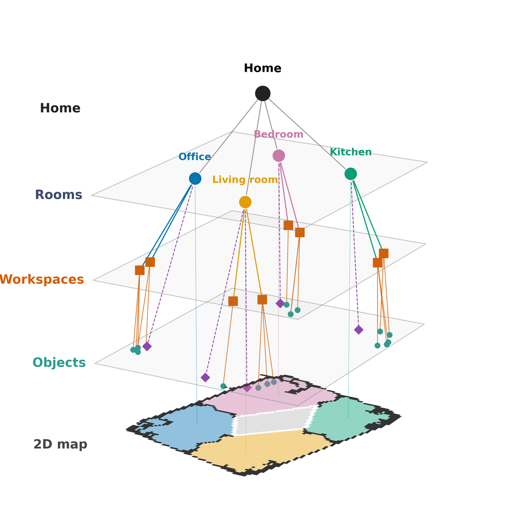

# AtHOME: Object Search with a Hierarchical Scene Graph and a Small LLM Planner

A home robot that finds objects on request ("find the laptop"), including objects that are not in its map.
A hierarchical scene graph (Room → Workspace → Object) compresses the home into a few candidate places, and a
4B-parameter LLM, distilled with GPT-4.1 as the teacher, decides where to look next.

Team project of the BARAM robotics club (2026). This repository holds the scene graph, the search planner and its
training, and the search executor on ROS 2; perception and motion live in the teammates' repositories
([Team](#team-and-contributions)).


<sub>Found photos from the real robot in room_baram: the green box is the 3D box of the matched object projected into the image.</sub>

<!-- TODO: 2-3 min demo video (robot view + RViz) after the final experiment -->

## Why a scene graph and a small LLM

- **Where would it be?** An unknown target should be looked for where it plausibly is, not at the nearest place
  first. The scene graph keeps which room and which furniture surface each object belongs to, so the planner can
  reason about plausible places.
- **Small enough for a small model.** Grouping objects under their furniture (Workspaces) cuts the planner prompt
  from ≥ 20,615 to 3,990 tokens per episode and the candidates per query from 84.7 to 6.2.
- **Fast enough for a robot.** The distilled Qwen3-4B planner matches the GPT-4.1 teacher on the same episodes and
  decides in 0.65 s instead of 2.61 s, on our own server.
- **Connected to motion.** Every Search Location carries a 3D box, so a decision becomes a reachable goal pose
  with a clear view of the furniture.

## Results

### Simulation (HM3D-Sem, held-out buildings)

Scene graph ablation, untrained Qwen3-4B (zero-shot), Val + Test buildings, ObjectNav start rule (shortest path
1–30 m, 1,226 episodes), success within 500 steps:

| Representation | SR ↑ | SPL ↑ | Visits ↓ | Prompt tokens / episode ↓ |
|---|---|---|---|---|
| **Hierarchical scene graph (ours)** | **0.884** | **0.423** | **8.2** | **3,990** |
| w/o Workspace layer | 0.841 | 0.409 | 11.3 | 8,691 |
| Unstructured object list | 0.821 | 0.371 | 13.9 | ≥ 20,615 |

The object list exceeded the 4,096-token context in 15.8 % of queries; its success reflects that the input no
longer fits a small model.

Planner distillation, Val buildings (835 episodes, same start rule):

| Planner | SR ↑ | SPL ↑ | Visits ↓ | Decision latency ↓ |
|---|---|---|---|---|
| GPT-4.1 teacher | 0.951 | 0.480 | 4.4 | 2.61 s |
| Qwen3-4B + LoRA SFT | 0.941 | 0.492 | 4.4 | 0.65 s |
| Qwen3-4B + LoRA SFT + GRPO | 0.946 | 0.506 | 4.6 | 0.65 s |

SFT vs teacher: visits +0.01 (95 % CI −0.64, +0.82), SPL +0.012 (−0.018, +0.038), i.e. comparable, not better.
GRPO did not improve the search cost over SFT on the holdout or Val buildings, also after reducing reward ties
within groups (40 % → 14 %); its setup is in `docs/gpu_server_handoff_ko.md`.

Room segmentation on HM3D-Sem regions (36 buildings, 435 rooms): precision 0.952, recall 0.837 (morphological
baseline: 0.791 / 0.949).

### Real robot (room_baram, development runs)

Four rooms and a hall, 53 commands with 21 object categories, 2026-11-06:

| Target | Commands | SR ↑ (95 % CI) | SPL ↑ | Search steps ↓ | Found at 1st step | Median time |
|---|---|---|---|---|---|---|
| Known (in the scene graph) | 40 | 80 % (65–90) | 0.714 | 1.03 | 31/32 | 19 s |
| Unknown (LLM planner) | 13 | 85 % (58–96) | 0.562 | 1.91 | 5/11 | 120 s |
| All | 53 | 81 % (69–89) | 0.676 | 1.26 | 36/43 | 19 s |

Success means the robot declared the target found and the found photo shows it (3 photos too far to tell are
counted; 41/53 without them); commands the operator canceled are failures. Excluded: 4 commands whose name did not
match the graph (bug fixed afterwards) and 5 attempts at the spoon, later removed from the task objects. These are
development runs with settings changing between runs; the controlled comparison below replaces them.

**Final experiment (in progress).** 20 placements of objects not in the graph, each searched by the trained planner
and by the untrained Qwen3-4B, in a counterbalanced order, with success and failure rules fixed before the runs:
[experiments/room_baram_final](experiments/room_baram_final).

## System





| Stage | What it does | Code |
|---|---|---|
| Scene graph construction | Rooms from walls and door lines; furniture that holds objects becomes a Workspace (LLM labels, 9-vote majority); objects attach to the Workspace under them | `src/athome/scene_graph/`, `scripts/build_scene_graph.py` |
| Search planning | Room selection, then Search Location selection; observed state and travel cost in the prompt; minimum-cost fallback | `src/athome/search/`, `src/athome/inference/` |
| Goal poses | Viewing distance per kind (desks 1.0 m, floor objects 2.0 m), line of sight through the walls map, same room first, no view across other furniture | `src/athome/navigation/` |
| Execution | Visit, 6 observation headings, re-look at near misses, found check (confidence, 2 confirmations, CLIP rank ≤ 5) | `src/athome/execution/`, `ros2/athome_ros/` |
| Training | GPT-4.1 teacher labels checked against ground truth, LoRA SFT, GRPO | `src/athome/training/`, `scripts/train_*.py` |
| Symbolic evaluation | The same search rules on HM3D without rendering (2D wall line of sight) | `src/athome/symbolic/`, `scripts/compare_graph_representations.py` |

## Limitations

- One real home layout, and the real-robot numbers above come from development runs.
- The map is built before the search; objects are assumed fixed (new objects are only added online).
- Small objects (spoon, toothbrush) get few LiDAR points for a 3D position; look-alikes cause false positives
  (a desk's front panel read as a drawer).
- Simulation and real-robot SPL are computed under different conditions and are not directly comparable.

## Repository structure

```
src/athome/      Python package (no ROS dependency)
  scene_graph/   rooms, workspaces, object assignment, labels, queries
  search/        search session, policies, matching, found check
  inference/     LLM planner client, prompts, command parser
  navigation/    occupancy grid, goal poses, path costs
  execution/     visit executor, run log, found photos
  perception/    3D boxes from 2D detections and LiDAR, CG-D wrapper
  training/      teacher labels, SFT / GRPO data and training
  symbolic/      offline evaluation environment on HM3D
ros2/            ROS 2 Humble packages: search server, operator console, perception node, launch files
configs/         robot configs (maps, goal rule, planner, matcher), training and perception settings
scripts/         dataset building, training, evaluation and analysis entry points
experiments/     pre-registered experiment protocols
tests/           pytest suite (368 tests, no ROS or GPU needed)
docs/            decision log against the proposal, pipeline notes (Korean)
deploy/          planner server (vLLM with LoRA adapters)
```

## Installation and usage

```bash
conda env create -f environments/athome-data.yml && conda activate athome-data
pip install -e .
PYTHONPATH=src:scripts python -m pytest            # unit and integration tests

# ROS 2 Humble packages
source /opt/ros/humble/setup.bash
colcon build --symlink-install --base-paths ros2 && source install/setup.bash

# search on the robot (perception, localization and MPPI run from their own repositories)
ros2 launch athome_bringup realtime_search.launch.py \
    robot_config:=$PWD/configs/robot/room_baram.yaml rviz:=true
```

HM3D-Sem scenes are not redistributed here; request access from the dataset authors. Server addresses and keys come
from a local `.env` (never committed).

## Development conventions

- One topic per commit, a summary line that says what changed, and the test suite passing at every commit.
- Decisions that depart from the proposal are logged with their evidence in `docs/proposal_alignment_ko.md`.
- Experiments are fixed (scenarios, order, success rules) and committed before the runs, so results cannot shape
  the rules.
- Robot configs carry the reason for each value next to it.

## Team and contributions

| Member | Role | Repository |
|---|---|---|
| 이성민 (@robotjdals) | Hierarchical scene graph, search planning and execution, LLM planner data and training (teacher labels, SFT, GRPO), simulation and real-robot evaluation | this repository |
| 윤동건 | Perception: LiDAR–camera fusion, open-vocabulary detection (CG-D), SLAM and localization | [DongGeonYoon/athome](https://github.com/DongGeonYoon/athome) |
| 문상훈 | Motion: MPPI local planner, Nav2 integration | [moon0108/Nav2Tidy](https://github.com/moon0108/Nav2Tidy) |

## References

- Hierarchical scene graphs for object navigation: HSG-ON (Sensors 2026), Hydra, HOV-SG
- LLM search planning on scene graphs: MoMa-LLM (RA-L 2024), SayPlan
- Small planner distillation: SmallPlan (arXiv 2505.00831)
- Search with spatial priors: SLiM (ICRA 2020), Kollar & Roy (2009)
- Data and models: HM3D-Sem, HM3D-OVON splits, Qwen3-4B, vLLM, Nav2
