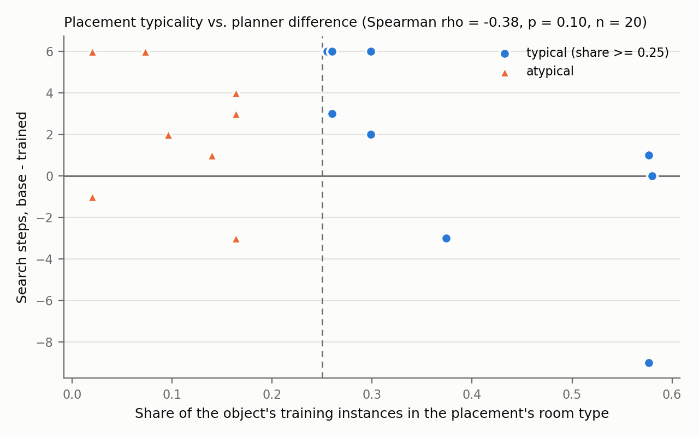

# 최종 실험 결과: 학습된 플래너 vs 학습 안 된 플래너 (room_baram)

2026-11-11~12, 절차서(`protocol_ko.md`)에 사전 등록한 분석 그대로. 재현: `scripts/analyze_final_experiment.py` (기록 `outputs/room_baram/experiments/room_baram_final/`, 이 폴더의 `analysis.json`).

## 실행
- 배치 20개 × 플래너 2개 = 유효 40회. 무효 0회, 판정 전 중단 1회(시나리오 7 trained, 다시 시행).
- 모든 회가 복도 한 지점에서 출발, 명령당 600초. 기록된 플래너가 40회 모두 계획과 일치.
- 실험 도중 남은 시나리오의 진행 순서만 물체별로 묶음(배치·쌍 순서는 그대로).

## 주 결과
| 지표 | trained | base |
|---|---|---|
| 성공률 (95% Wilson) | 19/20 (95%) (76-99%) | 19/20 (95%) (76-99%) |
| 300초 안 성공 (SR@300) | 19/20 (95%) | 11/20 (55%) |
| SPL | 0.465 | 0.395 |
| 방문 수 중앙값 | 2 | 4.5 |
| 시간 중앙값 | 94초 | 223초 |
| 이동 거리 중앙값 | 7.4 m | 10.5 m |
| 첫 방 정확도 | 6/20 (30%) | 4/20 (20%) |
| LLM 실패로 규칙 대체 | 0/114 | 0/204 |

짝지은 비교 (base − trained, 20쌍):
| | 차이 중앙값 | trained 우세 / base 우세 / 같음 | 검정 |
|---|---|---|---|
| 방문 수 | 2.5회 | 14 / 4 / 2 | Wilcoxon p = 0.027 |
| 시간 | 124초 | 15 / 5 / 0 | Wilcoxon p = 0.015 |
| 이동 거리 | 2.7 m | 12 / 8 / 0 | Wilcoxon p = 0.33 |
| 성공 | | trained만 1, base만 1 | McNemar 정확 p = 1.00 |

해석: 성공률은 같다(둘 다 19/20). 학습된 플래너는 같은 물체를 **더 적은 방문(중앙값 2 vs 4.5)과 더 짧은 시간(차이 중앙값 124초)**으로 찾았고, 둘 다 유의하다. 300초 안 성공은 19 vs 11. 이동 거리 차이는 유의하지 않다(학습된 플래너가 방문은 적지만 먼 곳을 고른 회가 있음).

## 실패 원인
| 회 | 플래너 | 원인 |
|---|---|---|
| 시나리오 10 | base | 시스템 중단: 주행 모듈이 회전 뒤 정지를 확인하지 못함(같은 동작 재요청 후에도) |
| 시나리오 15 | trained | 인식 누락: 첫 방문으로 정답 위치(거실 desk_79)에 갔으나 어두운 조명에서 식물을 검출하지 못하고 시간 초과 |

두 실패 모두 플래너의 위치 선택 때문이 아니다. 영상: `videos/run_20_s10_base.mp4`, `videos/run_30_s15_trained.mp4`.

## 보조 분석: 배치의 그럴듯함 (경향만)
Spearman rho = -0.38 (p = 0.10). 방문 수 차이 중앙값 typical 2, atypical 3. 학습 데이터에서 드문 방(atypical)일수록 차이가 커지는 경향이지만 유의하지 않다. 매우 흔한 배치(비율 0.58)는 두 플래너 모두 바로 찾았다. 가장 아래 점(-9)은 시나리오 15의 인식 실패.

## 시나리오별
| 시나리오 | 물체 | 방 | typicality | trained 방문 / 시간 | base 방문 / 시간 |
|---|---|---|---|---|---|
| 1 | laptop | office | typical | 1 / 28초 | 1 / 27초 |
| 2 | book | office | typical | 1 / 22초 | 3 / 121초 |
| 3 | plant | living_room | typical | 1 / 19초 | 2 / 72초 |
| 4 | laptop | kitchen | atypical | 4 / 154초 | 10 / 575초 |
| 5 | book | bedroom | typical | 2 / 72초 | 8 / 388초 |
| 6 | plant | kitchen | atypical | 4 / 196초 | 8 / 410초 |
| 7 | laptop | office | typical | 1 / 20초 | 1 / 19초 |
| 8 | book | bedroom | typical | 2 / 74초 | 8 / 366초 |
| 9 | plant | bedroom | atypical | 3 / 116초 | 6 / 265초 |
| 10 | laptop | kitchen | atypical | 3 / 122초 | 2 / 165초 (실패) |
| 11 | book | living_room | typical | 4 / 160초 | 1 / 11초 |
| 12 | plant | office | atypical | 2 / 96초 | 4 / 185초 |
| 13 | laptop | bedroom | typical | 2 / 82초 | 8 / 379초 |
| 14 | book | kitchen | atypical | 5 / 234초 | 11 / 547초 |
| 15 | plant | living_room | typical | 12 / 643초 (실패) | 3 / 120초 |
| 16 | laptop | living_room | atypical | 2 / 92초 | 3 / 113초 |
| 17 | book | office | typical | 1 / 19초 | 7 / 312초 |
| 18 | plant | kitchen | atypical | 4 / 172초 | 1 / 29초 |
| 19 | laptop | bedroom | typical | 2 / 64초 | 5 / 261초 |
| 20 | book | kitchen | atypical | 4 / 174초 | 10 / 509초 |

## 측정 메모
- 이동 거리: 주행 모듈 기록(`motion/real_*.csv`)의 주행 단계만 합산. 제자리 회전·정지 단계의 위치 흔들림(실험 전체 367 m)은 제외. 주행 단계 합은 계획 경로 길이와 10% 안에서 일치.
- SPL 최단 경로: 매 회의 실제 출발 자세에서 계산. 침실은 모든 탐색이 지정 자리에서 시작하므로 그 자리까지.
- 성공: 발견 선언 + 발견 사진의 박스에 놓은 물체(운영자 판정, 40회 사진 재확인) + 600초 이내. 다른 방에서 멀리 보고 찾은 회(시나리오 16, 19, 20 등)도 박스가 놓은 물체이므로 성공.

## 한계
- 집 한 곳, 물체 3종, 배치 20개. 성공률 차이를 가를 표본은 아니다.
- 조명이 어두운 자리에서 식물 인식 실패. 검출기는 학습하지 않은 범용 모델.
- 주행 모듈의 정지 확인 실패가 사무실에서 반복(실험 중 10회, 재요청으로 9회 해소, 1회 실패).
- 랩 GPU 공유로 검출 시간이 0.6~2.1초 사이에서 변함(시간 지표에 영향, 짝 안에서는 같은 조건).
